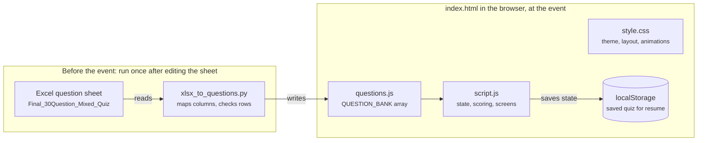
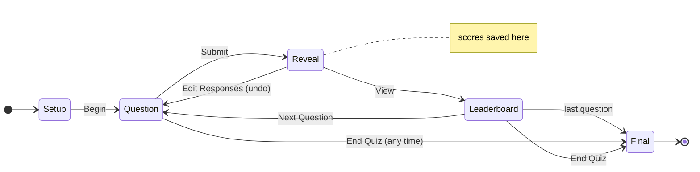

# BrainWave Quiz — How It Is Built

A browser-based console for running a live team quiz from a projector. No install, no server: open `index.html` and play.

## Overview

BrainWave is a browser-based console for running a live team quiz from a projector, operated by one quizmaster. Teams answer aloud or on paper; the quizmaster enters each team's choice, reveals the answer, and the page scores, ranks and celebrates automatically.

The quiz runs in a fixed cycle:

1. **Setup** — enter the quiz title, the number of teams (2–20) and their names, the points per correct answer, and how many of the 30 questions to play.
2. **Question** — the question and its four options (A–D) appear beside a panel with A/B/C/D buttons for every team.
3. **Reveal** — Submit & Reveal Answer scores every team, highlights the correct option, and shows the explanation and how many teams got it right.
4. **Leaderboard** — standings after that question, with rank changes and points gained.
5. **Repeat or end** — Next Question returns to step 2; End Quiz (available at any time) or finishing the last question shows the final podium and ranking table.

## Technology choices

The app is plain HTML, CSS and JavaScript with no framework, no server and no build step. Opening `index.html` in a browser is the whole deployment, so it runs offline on any laptop at the venue.

| Layer | Technology | Why |
| --- | --- | --- |
| Structure | HTML5, one page with five screens | All screens live in one file and are shown or hidden, so switching is instant |
| Styling and animation | CSS3: grid, flexbox, custom properties, keyframes, `@property` | Animations run on the browser's compositor without any library |
| Logic | Vanilla JavaScript (ES2020), one script wrapped in an IIFE | No dependencies to install; nothing leaks into the global scope |
| Effects | HTML5 Canvas 2D | Confetti particles drawn at 60 fps |
| Storage | Browser `localStorage` | Quiz progress survives an accidental refresh |
| Question import | Python 3 standard library (`zipfile`, `xml.etree`) | Reads the Excel file without installing any package |
| Fonts | Google Fonts: Playfair Display, Inter, JetBrains Mono | Formal serif headings, readable body text, code in monospace; system fonts are used when offline |

## Project structure

The project is six files in one folder, about 2,200 lines in total.

The Python converter runs only when the sheet changes; at the event the browser loads three files and keeps its progress in localStorage.

| File | Lines | Role |
| --- | --- | --- |
| `index.html` | 209 | Page skeleton: top bar, the five screens (setup, question, leaderboard, final), the splash overlay, the confirmation dialog and the fullscreen-return button |
| `style.css` | 750 | All visual design: colour tokens, glass cards, layouts, responsive rules and every animation |
| `script.js` | 813 | All behaviour: setup validation, quiz state, scoring, ranking, rendering, animation sequencing, fullscreen and confetti |
| `questions.js` | 337 | The question bank as a JavaScript array (`QUESTION_BANK`), generated from the spreadsheet |
| `xlsx_to_questions.py` | 114 | Converter that reads the Excel file and writes `questions.js` |
| `Final_30Question_Mixed_Quiz.xlsx` | — | Source of the 30 questions, maintained by the organisers |

`index.html` loads `questions.js` before `script.js`, so the question bank is available when the app starts. Loading the questions as a script rather than fetching a JSON file is deliberate: browsers block `fetch` on `file://` pages, and a script tag works without a server.

## Question data pipeline

Questions are authored in Excel and converted once into `questions.js`; the web page never reads the spreadsheet directly. Running `python3 xlsx_to_questions.py` regenerates the bank after any edit to the sheet.

1. **Read the workbook.** An `.xlsx` file is a ZIP archive of XML files. The script opens it with `zipfile`, loads the shared-strings table, and walks the first worksheet's rows with `xml.etree`.
2. **Find the columns by header name**, so column order in the sheet does not matter.
3. **Validate each row.** A row needs question text, four options and a correct answer of 1–4 (or A–D); anything else is skipped and reported as a warning.
4. **Write `questions.js`** as a JSON array assigned to `const QUESTION_BANK`, with the answer stored as a letter.

| Spreadsheet column | Used for |
| --- | --- |
| Question Text | The question; text after a blank line (a code snippet) is shown as a code block |
| Option 1–4 | Options A–D |
| Correct Answer | Option number 1–4, converted to letter A–D |
| Answer explanation | One line shown under the correct answer on reveal |
| Question Type, Option 5, Time in seconds, Image Link | Not used |

When the page loads, `normalizeBank()` in `script.js` checks every question again and skips any malformed entry, so a hand-edited `questions.js` cannot break the quiz.

## Application logic

The whole quiz is driven by one `state` object; every screen is drawn from it, and it is saved after every change. This makes behaviour predictable and lets a refreshed page resume exactly where it stopped.

Scores change only on entering Reveal; Edit Responses steps back one phase, and End Quiz can jump to the final results from any question.

| Field | Holds |
| --- | --- |
| `title`, `points` | Quiz name and points per correct answer |
| `teams` | One entry per team: `name`, `score`, `correct` (number of correct answers) |
| `questions` | The questions chosen for this quiz, already in play order |
| `qIndex` | Index of the current question |
| `phase` | `question`, `reveal`, `leaderboard` or `final` |
| `responses` | Map of team index to the option (0–3) entered for the current question |
| `prev` | Scores, correct counts and ranks just before the last reveal |
| `played` | Number of questions revealed so far |

**Scoring.** `reveal()` first copies the current scores into `prev`, then adds `points` to every team whose response equals the answer, moves the phase to `reveal` and saves. Scoring happens before any animation, so a refresh mid-animation can never lose or double-count points.

**Undo.** Edit Responses (shown after a reveal) restores scores from `prev` and returns to the `question` phase, so a mis-entered answer can be fixed before moving on.

**Ranking.** `rankRows()` sorts teams by score, highest first, and uses standard competition ranking: tied teams share a rank and the next rank is skipped (1, 2, 2, 4). Comparing ranks in `prev` with the new ones gives the ▲/▼ movement arrows, which are hidden after the first question because every team started tied.

**Persistence.** `save()` writes the state to `localStorage` as JSON after every change. On load, if an unfinished quiz is found, the setup screen offers Resume or Discard; `route()` then redraws the screen for the saved phase.

**Guards.** A `busy` flag blocks clicks while an animated transition runs, and each action checks the current phase, so double clicks cannot score a question twice.

**Optional shuffles.** Question order and A–D option order can each be shuffled at setup (Fisher–Yates). Option shuffling remaps the correct answer to its new position; both are off by default, so the letters match the spreadsheet.

## User interface and layout

The design is a dark navy theme with gold accents: formal enough for an academic event, high-contrast enough for a projector. Every colour, radius and easing curve is a CSS custom property on `:root`, so the theme changes in one place.

| Screen | What it shows | Layout technique |
| --- | --- | --- |
| Setup | Title, team count stepper, team-name inputs, points, question count, shuffle switches; resume banner when a saved quiz exists | Two-column CSS grid; team inputs in an auto-fill grid |
| Question | Question card with options A–D; Team Responses panel with A/B/C/D buttons per team and the Submit button | Full-viewport two-column grid (see below) |
| Leaderboard | Ranked rows with rank badge, name, movement arrow, points gained, score bar and score | Flex column; compact rows above 5 teams so it fits one screen |
| Final | Winner title, podium for the top three, full table with correct count, accuracy and score | Flex podium ordered 2nd · 1st · 3rd; responsive table |

Cards use a glass effect: a translucent gradient fill, a thin light border and `backdrop-filter: blur()` over the animated background.

**Full-screen question layout.** On screens 1,100 px or wider, the question screen fills the viewport exactly:

- `main` takes the viewport height minus the 68 px top bar (`100dvh`), and the screen becomes a flex column.
- The question card and responses panel sit in a grid of `1fr` and `clamp(360px, 27vw, 520px)`, stretched to equal height.
- The four options form a 2 × 2 grid with `grid-auto-rows: minmax(64px, 1fr)`, so they grow to fill the card and shrink when the answer banner appears.
- Team rows are flex items with `flex: 1 1 0`, a 54 px minimum and a 19vh maximum, so any team count shares the panel height.
- Font sizes, option letters and buttons use `clamp()` with `vw`/`vh` units, so a 1080p projector gets larger text than a laptop.

It was checked to fit without scrolling at 1460 × 870 and 1920 × 1080, before and after the reveal.

**Smaller screens.** Below 1,100 px the panels stack vertically; below 720 px the options and setup fields become a single column and the leaderboard tightens.

## Animations and visual effects

All animation is CSS keyframes and transitions, sequenced by JavaScript with timers and `async`/`await`; only confetti uses a canvas. Users with the operating system's Reduce Motion setting get the same content with animations switched off.

| Effect | When | How it is built |
| --- | --- | --- |
| Question splash | Before each question ("Question 5", "Final Question") and before results | Full-screen overlay; title zooms in with expanding rings; fades out after 1.3 s or on click; `splash()` returns a Promise the caller awaits |
| Option entrance | Question appears | Staggered `optionIn` keyframes (100 ms apart) with a slight 3D tilt |
| Suspense sweep | After Submit | `reveal()` loops a gold highlight across A–D, each step slower (70 ms rising to about 330 ms), stopping on the correct option |
| Answer reveal | After the sweep | Correct option glows and pulses, its ✓ is an SVG path drawn with `stroke-dashoffset`; wrong picks shake; unpicked options dim |
| Team results | After the sweep | Team cards flip in one by one (`rotateX`, 90 ms apart) with ✓ +10 / ✗ 0 badges and a floating +10 |
| Leaderboard reorder | Leaderboard opens | FLIP technique: rows start at their previous positions via the CSS `translate` property, then slide to their new ranks while bars grow and scores count up |
| Score count-up | Leaderboard | `requestAnimationFrame` loop with cubic ease-out over 1.2 s |
| Podium and spotlights | Final screen | Podium blocks rise from the base (`scaleY`), two light beams sway, crown bobs above the winner |
| Confetti | Correct answers and final results | Canvas particles with gravity, drag and spin; the loop stops when the last particle leaves the screen |
| Ambient background | Always | Blurred colour orbs drifting, a masked grid, 70 twinkling stars generated at start |
| Rotating light border | Main cards | Conic gradient on a `::before` ring, rotated by animating an `@property --angle` custom property |
| Button feedback | Any click | Light sheen on hover; a ripple span added at the pointer position and removed after 650 ms |

## Fullscreen handling and safeguards

Fullscreen uses the browser Fullscreen API on the whole page, with the `webkit`-prefixed calls as a fallback for Safari. Three measures keep it stable during a live event:

- **No stray toggles.** Every button gives up keyboard focus after a mouse click, so a later Space or Enter press cannot switch fullscreen off.
- **Clear state.** The button reads "Exit Fullscreen" while active, updated from the `fullscreenchange` event.
- **One-click recovery.** Browsers always leave fullscreen on Esc, printing or a page reload. If that happens while the quizmaster wanted fullscreen, a "Return to fullscreen" button slides up at the bottom of the screen.

Other safeguards for live use:

- A confirmation dialog appears before submitting with unanswered teams, and before ending the quiz early.
- Team names must be unique, points must be at least 1, and the question count must be within the bank.
- All team names and question text are HTML-escaped before display, so any characters typed in render as plain text.
- Every `localStorage` call is wrapped in `try`/`catch`, so the quiz still runs in a private window where storage is blocked.

Opening the page through VS Code's Live Server reloads it on every file save, which exits fullscreen; for the event, open `index.html` directly in Chrome.

## Testing

The quiz was tested end to end in headless Google Chrome, driven through the Chrome DevTools Protocol with a small Node.js script, using real-time animations.

- **Full flow:** a 6-team quiz was set up, answers entered, revealed, viewed on the leaderboard, advanced, and ended early. Final scores in saved state matched the hand-calculated totals, with no console errors.
- **Scoring edge cases:** a team left unanswered (confirmation dialog, 0 points) and tied scores (shared ranks).
- **Option shuffle:** all 30 questions were shuffled and each correct answer still pointed to the right option text (0 mismatches).
- **Layout:** screenshots at 1460 × 870, 1920 × 1080 and 1280 × 720, before and after the reveal and on a code question, compared page height with window height to confirm no scrolling.
- **Syntax:** `node --check` on `script.js` and `questions.js` after every change.

## Running and maintaining

**To run:** open `index.html` in Chrome, click Fullscreen, enter the teams and press Begin Quiz. No installation or internet connection is needed.

**To change the questions:**

1. Edit `Final_30Question_Mixed_Quiz.xlsx` (keep the column headers).
2. Run `python3 xlsx_to_questions.py` in the project folder.
3. Reload the page; the setup screen shows the new question count.

**Known limits:**

- One operator enters every answer; teams do not use their own devices.
- Exactly four options per question; the sheet's Option 5, timer and image columns are ignored.
- Saved progress lives in the browser on that one computer.
- On screens around 1280 × 720, a code question after the reveal runs about 20 px past the bottom edge.

**Possible extensions:** a per-question countdown from the sheet's "Time in seconds" column, question images from "Image Link", negative marking, and a CSV export of the final results.
